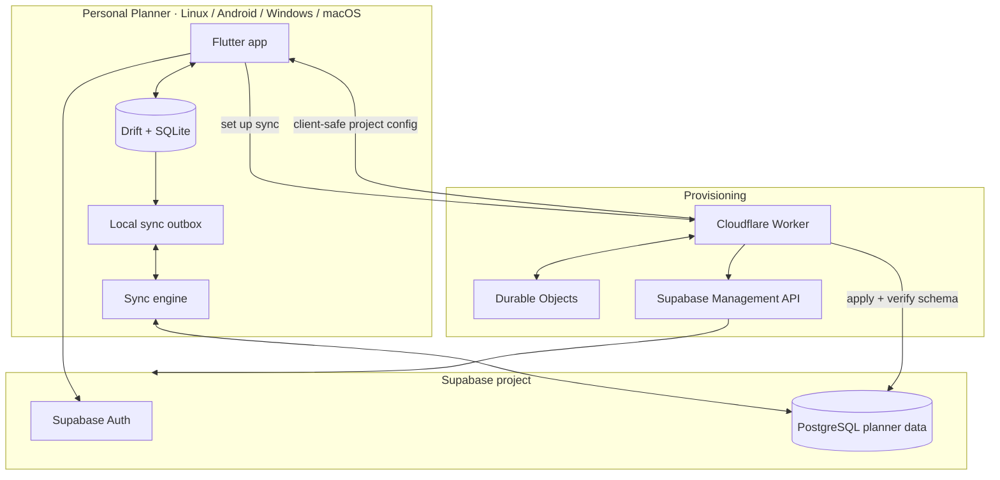

<p align="center">
  
</p>

<h3 align="center">Plan your day. See where your time actually went.</h3>

<p align="center">
  A free, offline-first planner for Linux, Android, Windows and macOS.<br>
  Make a plan, track what happens, and have something useful to look back on.
</p>

<p align="center">
  
  
  
  
</p>

<p align="center">
  <a href="https://github.com/Karthikshabari/PersonalPlanner/releases"><b>Download Personal Planner</b></a>
</p>

<p align="center">
  
</p>

<p align="center">
  <a href="#why-i-built-it">Why I built it</a> ·
  <a href="#what-you-can-do">What you can do</a> ·
  <a href="#download-and-install">Download</a> ·
  <a href="#under-the-hood">Under the hood</a> ·
  <a href="#support-the-project">Support</a>
</p>

---

**Want to see Personal Planner in action?**

Take a look at the [Personal Planner website](https://karthikshabari.github.io/PersonalPlanner/) for a quick demo, screenshots, and a closer look at how the app helps you plan your day, track your time, and learn from what actually happened.

## A planner that doesn't forget yesterday

I've used task lists where everything looks great at the end of the day because the boxes are ticked. But that doesn't tell me much. Did that 30-minute task take an hour? What kept getting pushed to tomorrow? Was the week actually going the way I thought it was?

**Personal Planner keeps the plan and the reality together.** You put tasks on a timeline, use a timer while you work, and come back later to see what happened. You can also write a few lines about the day or week, right next to your actual tasks and time spent.

It's a personal planner, not a team management tool. You can use it completely offline, without signing up or setting up a server. If you want to use it across devices, there's optional sync through a Supabase project you control.

## Why I built it

I used to set aside 30 minutes for something, spend an hour on it, and then make the next day's plan as though the first estimate had been right. I was planning every day, but not really learning from any of them.

I tried other planners, including Super Productivity, Vikunja, Planify and TickTick. They each do things well. What I kept missing was a simple way to look back: *this is what I planned, this is what I actually spent my time on, and this is why the rest didn't happen.* I also wanted to do that without paying a subscription just to see my own history.

So I started building Personal Planner. I use it myself, and the feedback from people who've tried it has helped shape what it is now.

The idea isn't to make every day look productive. Some days don't go to plan. I just wanted a place where those days are still worth looking at.

## What you can do

A normal day in Personal Planner is pretty straightforward: make a plan in **Day**, start a timer when you begin working, and use **Review** later to see how it went. **Insights** helps you notice patterns over time, while **Inbox** keeps ideas that aren't ready for the calendar yet.

### Plan your day on a timeline

Instead of making a list and hoping everything fits, you place tasks into actual hours. Drag a block to move it, resize it when plans change, and switch between day and week views.

- See overlapping blocks before they become a problem
- Use recurring activities and templates for the things you plan regularly
- Colour-code tasks with categories
- Move unfinished work forward without losing its history
- Undo and redo changes
- Work with a 24-hour clock throughout the app

<p align="center">
  
</p>
<p align="center"><sub>Day view: put tasks where they fit, then see how the day turned out.</sub></p>

### Find out how long things really take

Each task has a timer you can start, pause, resume and stop. When the task is finished, its actual time sits alongside the time you planned for it.

For example, if you allowed 30 minutes to work on something but spent 65, that difference is saved. Next time you're making a similar plan, you have something better to go on than a guess.

The timer also keeps its time when you close the app. Timer controls are available in notifications on Linux and Android.

### Review the day, not just the completed tasks

This is the part I wanted most when I started the project.

**Daily review** brings together the day's plan, completed and unfinished work, and the time spent across categories. You can record how the day felt and write whatever mattered. For skipped tasks, you can write your own reason rather than choosing a generic option. "I spent most of the afternoon fixing a bug" is a lot more useful when you read it back next month.

**Weekly review** helps you look at the week as a whole. It shows what got done, what was skipped or rescheduled, and gives you room to reflect or set an intention for the following week.

**Overview** lets you return to earlier days and weeks without digging through a completed-task list. Your notes and the data are in the same place. Draft reflections are saved if you leave halfway through writing one.

This isn't meant to be another daily chore. You can write as much or as little as you find useful.

<p align="center">
  
</p>
<p align="center"><sub>Daily review: the day’s work, the time it took, and your own notes.</sub></p>

<p align="center">
  
</p>
<p align="center"><sub>Weekly review: a clearer picture of what happened across the week.</sub></p>

<p align="center">
  
</p>
<p align="center"><sub>Overview: revisit earlier days and weeks without losing the context.</sub></p>

### See patterns over time

A single good or bad day doesn't tell the whole story. Insights gives you a longer view.

**Consistency** shows a year-long heatmap along with current and best streaks. It's useful for seeing stretches when you kept showing up, periods when things slowed down, and whether a routine has actually been consistent.

<p align="center">
  
</p>
<p align="center"><sub>Consistency: the bigger picture, not just today’s result.</sub></p>

#### Try a routine as an Experiment

Say you want to spend an hour learning C on weekdays for the next month. Instead of creating another tracker and logging the same work twice, you can make it an Experiment.

1. Add a tag, such as `Learn C`, to the relevant tasks.
2. Choose a start and end date.
3. Set targets for weekdays and weekends.
4. Choose when to check in, and write notes as you go.

As you complete tagged tasks, the experiment updates from the time you've already tracked. You can compare your progress with your target, see the days you met it, and check whether you're ahead or behind.

When the experiment ends, you can **conclude** it and write down what you learned, **extend** it with a reason, or **keep** it as an ongoing routine. Kept experiments continue tracking against a weekly minimum without an end date or check-ins.

I like this approach because it makes a new routine something you can actually evaluate, rather than something you vaguely remember starting.

<p align="center">
  
</p>
<p align="center"><sub>Experiments: test a routine using time you’ve already recorded.</sub></p>

### Keep ideas out of today's schedule until they're ready

Not everything you think of needs to become a task today. That's what Inbox is for.

You can save an idea, come back to it later, and then decide what to do with it:

- Put it on a particular day
- Break it into dated sessions, each with its own time and duration, for up to about two weeks
- Turn those sessions into tasks on the Day timeline
- Reschedule missed sessions from the **Left over** list
- Close or drop an idea with a reason, without pretending it was completed
- Restore a dropped idea or turn a longer-term idea into an Experiment

The Inbox works out the status from your sessions; you don't have to keep updating it manually. The goal is to keep an idea somewhere useful without letting it crowd every day's plan.

<p align="center">
  
</p>
<p align="center"><sub>Inbox: turn an idea into actual sessions when you’re ready for it.</sub></p>

### Use it offline. Sync only if you want to.

Everything you do starts with data stored on your device. Planning, timers, reviews and insights work without an internet connection.

If you use multiple devices, you can set up sync with your **own Supabase project**. Each device still keeps a local copy. Changes that haven't synced yet stay in a local outbox and are retried when connectivity returns. A small indicator shows sync status and the last sync time.

You don't have to enable any of this to use the planner on one device. There is no Personal Planner account required for local use, and I don't run a central server that stores everyone's planner data.

<p align="center">
  
</p>
<p align="center"><sub>Offline work stays on your device and can sync later if you enable it.</sub></p>

### A few other things worth knowing

- **Search:** find older entries in Review, Insights and Inbox with keyword search
- **Backup and restore:** move or recover your planner data
- **Lightweight by design:** attention has gone into keeping day and week navigation responsive and resource usage reasonable
- **No paid features:** the app is free, with no premium tier or subscription

## Is it a good fit for you?

You might like Personal Planner if you schedule work in blocks, often underestimate how long things take, want to reflect on your week without opening a separate journal, or are trying to make a routine stick.

It may not be the right fit if you're looking for a shared team planner, built-in connections to external calendars and work tools, or an iPhone/iPad app. Those aren't available right now.

## Download and install

Get the latest build from **[GitHub Releases](https://github.com/Karthikshabari/PersonalPlanner/releases)**. Release downloads include a `SHA256SUMS.txt` file if you'd like to verify the archive or APK.

| Platform | What to download / know |
| --- | --- |
| **Android** | Install the APK. Your phone may ask you to allow installation from your browser or file manager. |
| **Linux** | Download and extract the tarball, then run the included app. |
| **Windows** | Download and extract the ZIP. The build is unsigned; see below. |
| **macOS** | Download the ZIP and move the app to Applications. The build is unsigned; see below. |

Windows and macOS builds are distributed unsigned, so the operating system may display a warning. The macOS build has been checked in GitHub Actions, **not on a physical Mac**. I want to be clear about that before anyone installs it.

<!-- OPTIONAL PHOTO: the app running on Windows or macOS. If you add it, save as Photos/desktop.png and uncomment below.
<p align="center">
  
</p>
-->

### Windows

1. Extract the entire ZIP. Keep `personal_planner.exe`, the `.dll` files and the `data` folder together.
2. Run `personal_planner.exe`.
3. If SmartScreen blocks it, verify you downloaded it from this project's Releases page. Then use **More info → Run anyway** if you choose to proceed.

If sync setup fails with `CERTIFICATE_VERIFY_FAILED`, check Windows updates and the system's trusted root certificates. I encountered this while testing on Windows. The following command can retrieve Microsoft's root certificate list as part of troubleshooting:

```powershell
certutil -generateSSTFromWU roots.sst
```

This creates a `roots.sst` file; it does **not** install root certificates by itself.

### macOS

1. Unzip the download and move `Personal Planner.app` to **Applications**.
2. Try opening the app. macOS may block it because the build isn't signed.
3. If you trust the download, open **System Settings → Privacy & Security** and select **Open Anyway**.
4. If macOS still blocks the app, this removes its quarantine attribute. Only use it after checking the source of the download:

   ```bash
   xattr -dr com.apple.quarantine "/Applications/Personal Planner.app"
   ```

### Current platform limitations

- Reminders and timer notifications currently work on Linux and Android, not Windows or macOS.
- Email/password sign-in works on Windows and macOS, but some confirmation and provisioning links cannot open the app directly because the `com.personalplanner.personalplanner://` URL scheme isn't registered on those platforms.
- There is no iOS or iPadOS build.

## A few common questions

**Do I need an account?** Not for local use. Just install it and start planning. Sync setup uses Supabase authentication.

**Do I need internet?** No, unless you're setting up or using sync.

**Where does my data go?** It stays on your device. With sync enabled, it is also stored in your own Supabase project.

**Do I need to set up Supabase?** Only if you want to sync devices. Everything else works locally.

**Can I request a feature?** Yes. [Open an issue](https://github.com/Karthikshabari/PersonalPlanner/issues) and tell me what you're trying to do. Real examples help more than a long wish list.

## Under the hood

If you're only here to use the app, you can skip this section.

The main idea is simple: **the local database is the source the app works with during everyday use.** Sync is an optional layer, rather than something every screen has to wait for.



**Flutter + Riverpod** handle the app's interface and state. **Drift + SQLite** hold the planner data locally, so actions like moving a block or finishing a timer don't have to call a server. Changes waiting to sync are kept in a local outbox.

**Supabase Auth + PostgreSQL** provide authentication and a copy of the data for users who choose cross-device sync. Each device reads and writes locally and the sync engine handles moving changes between devices.

**Cloudflare Workers + Durable Objects** handle the optional provisioning flow. The Worker connects to the user's Supabase account, finds or creates a compatible project, runs and verifies the required schema migrations, and returns client-safe configuration. Durable Objects keep track of the multi-step setup. After provisioning, the app communicates with Supabase directly.

**Tech stack:** Flutter, Riverpod, Drift, SQLite, Supabase Auth, PostgreSQL, Cloudflare Workers and Durable Objects.

## Build from source

You can build the app from this repository and use it without setting up Supabase or Cloudflare. Only cross-device sync needs the extra services.

<details>
<summary><b>Build from source</b></summary>

```bash
flutter doctor -v

git clone https://github.com/Karthikshabari/PersonalPlanner.git
cd PersonalPlanner
flutter pub get
```

**Linux** (Fedora shown, use the equivalent packages on Ubuntu/Debian):

```bash
sudo dnf install clang cmake ninja-build pkgconf-pkg-config gtk3-devel

flutter run -d linux
flutter build linux --release
```

The release bundle lands in `build/linux/<architecture>/release/bundle/`.

**Android:**

```bash
flutter devices
flutter run -d <ANDROID_DEVICE_ID>

flutter build apk --debug
flutter build apk --release
```

The APK is written to `build/app/outputs/flutter-apk/`. Use your own signing config for release builds, and never commit keystores, passwords or `android/key.properties`.

**Windows and macOS:**

```bash
flutter build windows --release   # build/windows/x64/runner/Release/
flutter build macos --release     # build/macos/Build/Products/Release/Personal Planner.app
```

The `Desktop check` workflow (`.github/workflows/desktop-check.yml`) builds both on GitHub Actions and runs a smoke test on each.

</details>

<details>
<summary><b>Set up sync</b></summary>

### Option 1: Use your own Supabase project

If you already have a project with the Personal Planner schema applied:

```bash
cp supabase.example.json supabase.local.json
```

```json
{
  "SUPABASE_URL": "https://<YOUR_PROJECT>.supabase.co",
  "SUPABASE_PUBLISHABLE_KEY": "<YOUR_PUBLISHABLE_KEY>"
}
```

```bash
flutter run -d linux --dart-define-from-file=supabase.local.json
```

The project URL and publishable key are meant for clients, so that's fine. Management tokens, OAuth secrets, service-role keys and database passwords are not. Keep those out of the app and out of Git.

### Option 2: Use the provisioning flow

Deploy the Worker in `provisioning/` and point the app at it:

```bash
flutter run -d linux --dart-define=PROVISIONING_BASE_URL=https://<YOUR_WORKER_URL>
```

```bash
cd provisioning
npm ci
cp .dev.vars.example .dev.vars
```

The Worker needs these server-side values. They belong in the Worker environment, never in Flutter `--dart-define`:

```text
OAUTH_SESSION_KEY
SUPABASE_OAUTH_CLIENT_ID
SUPABASE_OAUTH_CLIENT_SECRET
SUPABASE_OAUTH_REDIRECT_URI
```

Before deploying:

```bash
npm run check
npm run deploy:dry
```

Once the Cloudflare environment and the Supabase OAuth callback are set up, deploy and use the Worker's HTTPS URL as `PROVISIONING_BASE_URL`.

</details>

## Bugs, suggestions and feedback

If something doesn't work, or if a screen is confusing, please [open an issue](https://github.com/Karthikshabari/PersonalPlanner/issues). Let me know which platform you're using, what you were doing, and what happened. A screenshot or steps to reproduce the issue help a lot.

I also appreciate feedback from people who simply tried the app and found something awkward. That's often more useful than another feature request.

<!-- If you add a LICENSE file, link to the actual license here. A public repository alone does not grant an open-source license. -->

LICENSE: https://github.com/Karthikshabari/PersonalPlanner?tab=MIT-1-ov-file

## Support the project

Personal Planner is free, and I want to keep it that way.If the app has been helpful share it with someone who might use it genuinely helps. If you'd rather support its development financially, you can do that through GitHub Sponsors(If you do thanks for your contribution as well :) ). And thanks for reading this far, have a great day :)

<p align="center">
  <a href="https://github.com/sponsors/Karthikshabari"><b>Sponsor Personal Planner on GitHub</b></a>
</p>
