<p align="center">
  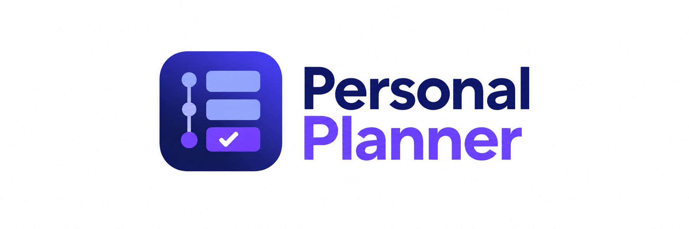
</p>

<h3 align="center">Plan your day. Track what really happened. Learn from it.</h3>

<p align="center">
  A free, local-first planner for Linux, Android, Windows and macOS.<br>
  Your past days stay useful, instead of disappearing into a "completed" list.
</p>

<p align="center">
  
  
  
  
</p>

<p align="center">
  <a href="https://github.com/Karthikshabari/PersonalPlanner/releases"><b>⬇ Download the latest release</b></a>
</p>

<!-- PHOTO 1 (hero): wide screenshot of the Day screen with a full, filled-in day. Save as Photos/hero_day.png -->
<p align="center">
  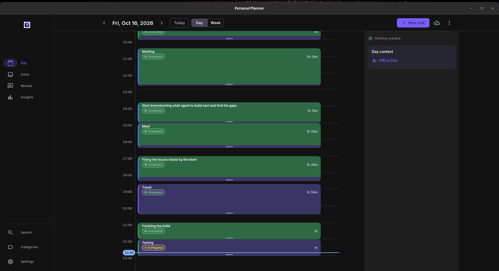
</p>

---

## Quick question

**What did you actually do last Tuesday?**

If you have to think hard, or scroll through a pile of ticked-off tasks to find out, this app is for you.

Most planners are good at tomorrow. The moment you finish something, it disappears. You never find out if that "2 hour" task really took 2 hours, whether this week was better than the last one, or if that new routine you started is actually sticking.

Personal Planner keeps the past. It lets you plan the day, do the day, look back at it, and learn from it, all in one place.

## Why I built this

I tried a lot of planners before this. Super Productivity, Vikunja, Planify, TickTick and a few more open source alternatives for Linux and Android.

Some of them were really good. But none of them did what I wanted, and the ones that came close kept the useful parts behind a paywall. I wasn't going to pay a monthly fee just to plan my own day.

So I built my own. It took me several months to get here, and it now runs on four platforms. I use it every day.

## Is this for you?

| If you've ever thought... | Personal Planner gives you... |
| --- | --- |
| "Where did my day go?" | Planned time and actual time, side by side |
| "I had a good week, I think?" | Daily and weekly reviews with the real data next to what you write |
| "Am I actually being consistent?" | A year-long heatmap and streaks |
| "Is this new routine working or not?" | Experiments that track themselves |
| "I have an idea but no time for it yet" | An Inbox that turns ideas into scheduled work |
| "I don't want yet another subscription" | Free, offline-first, your data is yours |

---

## The features, and why you'd care

### 📅 Day: plan it like a real calendar

The Day screen is an hour-by-hour timeline. Put a block on it, drag it to move it, pull the edge to resize it. That's it.

**Why it matters:** planning on a timeline makes you face how many hours you really have. It's much harder to lie to yourself when the blocks don't fit.

- Clashing blocks get flagged instead of silently stacking on top of each other
- Day view and week view
- Recurring activities and reusable templates, so you don't re-enter the same thing every week
- Categories to colour-code your time (Development, Personal, whatever you need)
- Didn't finish something? Carry it forward without losing where it came from
- Undo and redo, because plans change about five times a day

<!-- PHOTO 2: existing screenshot, planned and completed work on the Day screen -->
<p align="center">
  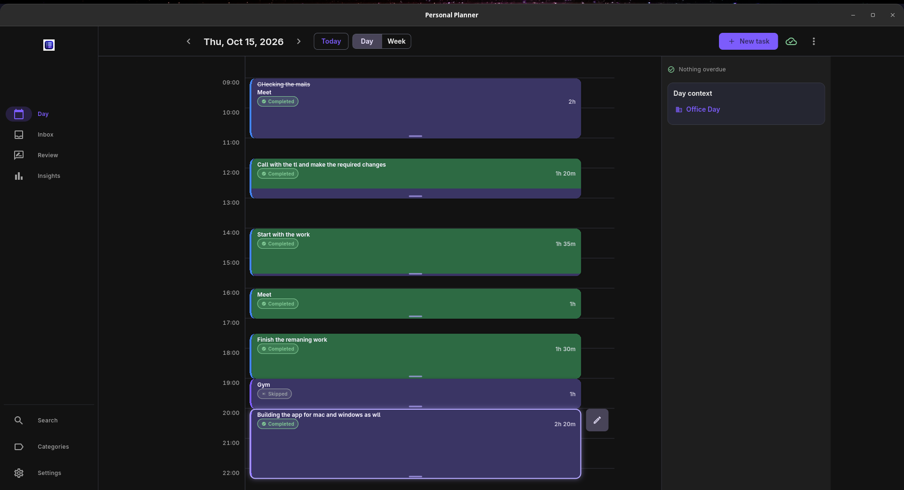
</p>
<p align="center"><sub>The plan is useful. What actually happened is more useful.</sub></p>

### ⏱ Timers: planned vs actual, finally in one place

Start, pause, resume and stop a timer straight from a task. When you complete a block, the minutes you really spent are saved next to the minutes you planned.

**Why it matters:** a two-hour block on the calendar and two hours of real focus are rarely the same thing. After a few weeks you'll know how you actually work, and your estimates get better. (Mine started out very wrong.)

Timer controls also show up in your notifications on Linux and Android.

### 📝 Review: look back at your day and your week

This is the part I care about most. Review has three views: **Daily**, **Weekly** and **Overview**.

**Daily review.** At the end of the day you see what you planned, what you finished and how your time was split across categories. Then you add your part:

- Pick how the day felt
- Write your own note
- For anything you didn't finish, write *why* in your own words. No preset dropdown, because "I got stuck on a bug and spent three hours on it" is more useful to you than "Not enough time"

**Weekly review.** Same idea, one level up. You get a "Your week" summary, pick how the week felt, write a few lines, and optionally set an intention for next week. It shows only the tasks that were skipped or rescheduled, so you see what slipped without a wall of noise. The tone is neutral on purpose. No red numbers, no guilt trips.

**Overview.** Scroll back through your past days and weeks as cards, each showing the mood you picked and how much you got done. Spot the pattern: *"Every week after a bad Monday, I skip Thursday."*

**Why it matters:** a normal journal lives in a different app from your tasks, so you write from memory. Here the real week is right next to your reflection, and your drafts are kept if you get interrupted mid-sentence. Reviews take a couple of minutes, not a ritual.

<!-- PHOTO 3: Daily review screen, with a day that has some completed and some unfinished tasks. Save as Photos/daily_review.png -->
<p align="center">
  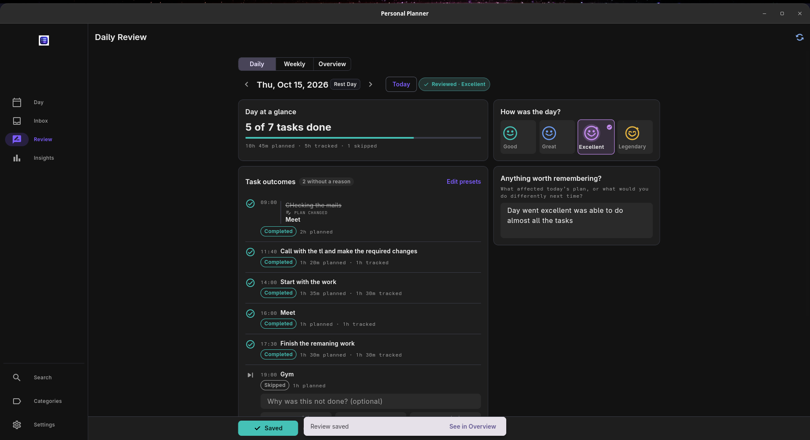
</p>
<p align="center"><sub>Daily review: what happened, how it felt, and why something didn't get done.</sub></p>

<!-- PHOTO 4: Weekly review screen. Save as Photos/weekly_review.png -->
<p align="center">
  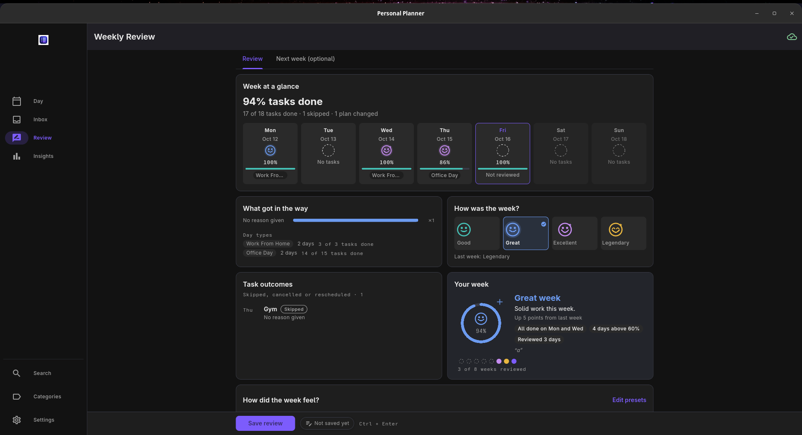
</p>
<p align="center"><sub>Weekly review: write it with the real week right beside it.</sub></p>

<p align="center">
  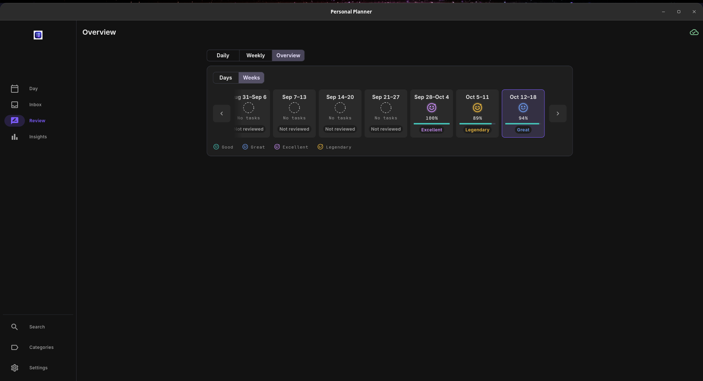
</p>
<p align="center"><sub>Overview: your last few weeks at a glance.</sub></p>


### 📈 Insights: see the long game

One bad day doesn't mean you're unproductive, and one good day doesn't mean you're fixed. Insights shows the longer picture.

#### Consistency

A year-long heatmap, like GitHub's contribution graph, plus your current and best streak.

**Why it matters:** it answers "have I actually been consistent?" with a picture instead of a feeling. Gaps, streaks and slow periods are easy to spot.

<!-- PHOTO 5: existing consistency heatmap screenshot -->
<p align="center">
  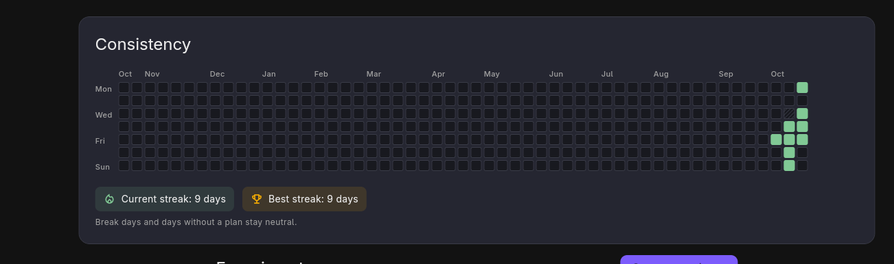
</p>
<p align="center"><sub>A longer view tells you more than a streak number.</sub></p>

#### Experiments

This is my favourite feature, so here's the plain version.

You want to try something for a few weeks. Learn C for an hour a day. Wake up earlier. Study on weekends. Normally you'd start, drift, and never know if it worked.

With an Experiment you set it up once:

1. **Pick a tag** for it, like `Learn C`. Tag the blocks on your Day screen that belong to it.
2. **Set the window**: a start date and an end date.
3. **Set targets**: for example 60 minutes on weekdays and 90 on weekends.
4. **Pick how often you want to check in** and write short notes on how it's going.

After that, you don't log anything extra. Every time you complete a block with that tag, the experiment updates itself. You see how much you've done against how much you should have done by now, whether you're ahead or behind, how many days you hit your target, and a chart that fits your screen without scrolling.

When the window ends you decide:

- **Extend it.** You have to write a reason, so you can't just keep pushing the deadline.
- **Conclude it.** Write down what you learned.
- **Keep it.** The experiment moves to a *Kept* list. No end date, no check-ins. It just keeps counting, and your weekday/weekend targets become a weekly minimum. Do more than the minimum and it simply shows as ahead.

**Why it matters:** most "new routines" fail quietly. This makes the result visible, from data you were already recording, so you can decide with facts instead of guilt.

<!-- PHOTO 6: Insights > Experiments showing one running experiment with progress and the chart. Save as Photos/experiments.png -->
<p align="center">
  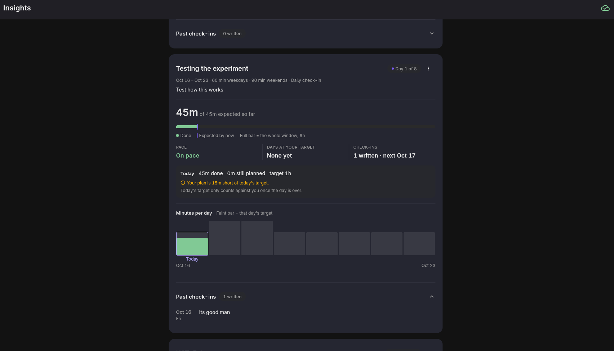
</p>
<p align="center"><sub>Try something for a few weeks and let your own data tell you if it worked.</sub></p>

### 💡 Inbox: for ideas that don't have a day yet

Everyone has ideas that come at the wrong time. "Research SAP." "Look into that library." "Plan the trip." If you put them on today's schedule, they're clutter. If you don't write them down, they're gone.

The Inbox is where they wait. Then, when you're ready:

- **Give it a date** and it becomes a task on that day
- **Or give it dated sessions** (up to about two weeks, each with a time and a length) and every session turns into a timed task on your Day screen. A research item that needs 45 minutes across five days is now five blocks, not one
- **Missed a session?** It doesn't vanish. It lands in a *Left over* backlog with a Missed badge, so you can reschedule it or let it go
- **Let go or Close it** with a reason you type yourself. It moves to *Dropped* instead of pretending it was *Done*
- **Start as an experiment** if an idea turns out to be something bigger than two weeks
- Bring back something you dropped, any time

You never set a status by hand. The Inbox works it out from the sessions, so it's always honest.

**Why it matters:** your head stays clear, and ideas don't rot in a list. They either become real work, or you consciously let them go.

<!-- PHOTO 7: Inbox screen with a few ideas, one expanded to show its dated sessions. Save as Photos/inbox.png -->
<p align="center">
  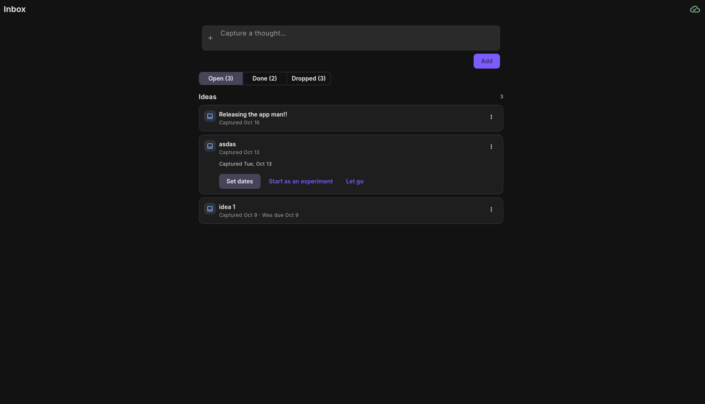
</p>
<p align="center"><sub>An idea with dated sessions. Each one becomes a timed task on the Day screen.</sub></p>

<p align="center"><sub>Capture it before it slips away.</sub></p>

### 🔄 Works offline, syncs when it can

The app reads and writes a local database first. That means moving a block, starting a timer or looking at an old day never waits for the internet.

- Plan on your Linux laptop, check it on your Android phone, and it all matches through Supabase sync
- No signal? Keep working. Your changes wait on the device and go through when you're back online
- A sync indicator shows what's happening (syncing, synced, and when it last synced)

<p align="center">
  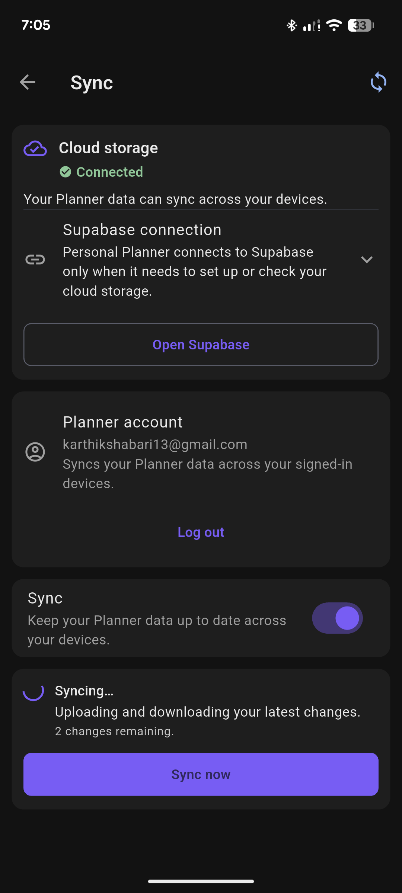
</p>
<p align="center"><sub>Offline? Keep working. Sync catches up later.</sub></p>

### 🪶 Light, free, and yours

- Built to stay light on RAM and CPU, with the screens tuned so switching days, weeks and tabs feels smooth
- Search to dig up something from weeks ago
- Free. No subscription, no locked features. Supabase and Cloudflare both have free tiers that are enough for personal use (their limits can change, so check them)
- Your planner data sits on your device and in your own Supabase project

---

## Download

Grab the build for your platform from the **[Releases page](https://github.com/Karthikshabari/PersonalPlanner/releases)**.

| Platform | Notes |
| --- | --- |
| Android | Install the APK. You may need to allow installs from your browser or file manager. |
| Linux | Extract the tarball and run the app inside. |
| Windows | Unsigned build. See below. |
| macOS | Unsigned build. See below. |

> I don't have an Apple developer account and I couldn't test on a real Mac, so the macOS build is only tested on GitHub Actions. The Windows build is unsigned, so Windows will warn you the first time. You just have to tell your OS you trust it.

<!-- OPTIONAL PHOTO: the app running on Windows or macOS. If you add it, save as Photos/desktop.png and uncomment below.
<p align="center">
  
</p>
-->

### Windows

1. Extract the whole zip. Keep `personal_planner.exe`, the `.dll` files and the `data` folder together.
2. Run `personal_planner.exe`.
3. If SmartScreen says "Windows protected your PC", click **More info**, then **Run anyway**.

**Setup fails with `CERTIFICATE_VERIFY_FAILED`?** This happened to me on Windows. It means Windows doesn't trust the root certificate needed to reach Supabase. Updating Windows and refreshing the root certificates fixed it for me:

```powershell
certutil -generateSSTFromWU roots.sst
```

Then restart the app and run setup again.

### macOS

1. Unzip and move `Personal Planner.app` to **Applications**.
2. Open it once. macOS will block it.
3. Go to **System Settings → Privacy & Security** and click **Open Anyway**.
4. If that button doesn't show up, or it says the app is damaged, run:

   ```bash
   xattr -dr com.apple.quarantine "/Applications/Personal Planner.app"
   ```

### Known limits on Windows and macOS

- Reminders and timer notifications only work on Linux and Android for now.
- Email and password sign-in works. Links that should open the app (the sign-up confirmation email and the provisioning authorization) don't, because the `com.personalplanner.personalplanner://` link scheme isn't registered on these two.

---

## Questions you might have

**Is it really free?** Yes. No paywall, no premium tier.

**Do I need internet?** No. Planning, timers, reviews and insights all work offline. You only need a connection to sync between devices.

**Do I have to set up sync?** No. You can use the app on a single device and never touch Supabase.

**Where is my data?** On your device, and in your own Supabase project if you turn sync on.

---

## How it works (for the curious)

The short version: the app works from a local database, and sync is an extra layer on top. Supabase handles sign-in and moves changes between your devices. A Cloudflare Worker sets up the Supabase project for you so you don't have to do it by hand.

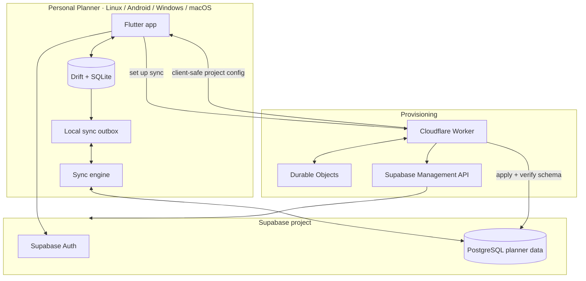

**Local first.** Drift on top of SQLite is the everyday store. Moving a block, finishing a task, starting a timer or opening an old day never waits on a server. Anything that still needs to sync sits in a local outbox until the connection is back.

**Supabase connects the devices.** Supabase Auth handles sign-in and PostgreSQL holds the data that needs to be shared. Each device keeps its own local copy, so the UI never blocks on the network.

**Cloudflare sets up the project.** A usable Supabase project needs the right schema, migrations, access rules and client config, and doing that by hand is painful. The Worker does it from inside the app: it connects your Supabase account, reuses a compatible project or creates a new one, applies the migrations and verifies the schema. Setup can take several steps, so Durable Objects keep track of its state in between. After setup, the Worker is out of the picture and the app talks to Supabase directly.

**Stack:** Flutter, Drift + SQLite, Riverpod, Supabase (Auth + PostgreSQL), Cloudflare Workers + Durable Objects.

## Build it yourself

You can run the app without touching Supabase or Cloudflare. Everything works locally, you just won't have sync.

```bash
flutter doctor -v

git clone https://github.com/Karthikshabari/PersonalPlanner.git
cd PersonalPlanner
flutter pub get
```

**Linux** (Fedora shown, use the equivalent packages on Ubuntu/Debian):

```bash
sudo dnf install clang cmake ninja-build pkgconf-pkg-config gtk3-devel

flutter run -d linux
flutter build linux --release
```

The release bundle lands in `build/linux/<architecture>/release/bundle/`.

**Android:**

```bash
flutter devices
flutter run -d <ANDROID_DEVICE_ID>

flutter build apk --debug
flutter build apk --release
```

The APK is written to `build/app/outputs/flutter-apk/`. Use your own signing config for release builds, and never commit keystores, passwords or `android/key.properties`.

**Windows and macOS:**

```bash
flutter build windows --release   # build/windows/x64/runner/Release/
flutter build macos --release     # build/macos/Build/Products/Release/Personal Planner.app
```

The `Desktop check` workflow (`.github/workflows/desktop-check.yml`) builds both on GitHub Actions and runs a smoke test on each.

## Set up sync

### Option 1: Use your own Supabase project

If you already have a project with the Personal Planner schema applied:

```bash
cp supabase.example.json supabase.local.json
```

```json
{
  "SUPABASE_URL": "https://<YOUR_PROJECT>.supabase.co",
  "SUPABASE_PUBLISHABLE_KEY": "<YOUR_PUBLISHABLE_KEY>"
}
```

```bash
flutter run -d linux --dart-define-from-file=supabase.local.json
```

The project URL and publishable key are meant for clients, so that's fine. Management tokens, OAuth secrets, service-role keys and database passwords are not. Keep those out of the app and out of Git.

### Option 2: Use the provisioning flow

Deploy the Worker in `provisioning/` and point the app at it:

```bash
flutter run -d linux --dart-define=PROVISIONING_BASE_URL=https://<YOUR_WORKER_URL>
```

```bash
cd provisioning
npm ci
cp .dev.vars.example .dev.vars
```

The Worker needs these server-side values. They belong in the Worker environment, never in Flutter `--dart-define`:

```text
OAUTH_SESSION_KEY
SUPABASE_OAUTH_CLIENT_ID
SUPABASE_OAUTH_CLIENT_SECRET
SUPABASE_OAUTH_REDIRECT_URI
```

Before deploying:

```bash
npm run check
npm run deploy:dry
```

Once the Cloudflare environment and the Supabase OAuth callback are set up, deploy and use the Worker's HTTPS URL as `PROVISIONING_BASE_URL`.

---
